# 微光星球 · LITTLE COSMOS

> 一座可以走进去的微缩星球。驾驶小火箭在三颗星球之间往返，采集、建造、认识陌生的生命。

一个用原生 Web 技术（HTML / CSS / JavaScript + Three.js）实现的 3D 星球探索与基地建造游戏垂直切片。**所有美术资源都是程序化生成**——没有外部模型、贴图或音频文件，打开就能玩。

---

## 快速开始

### 方式一：双击启动（推荐）

双击 `启动游戏.bat`。它会在本机启动一个静态服务器并打开浏览器。

### 方式二：直接打开

直接双击 `index.html` 也能运行（已打包为单文件 IIFE，支持 `file://` 协议）。

### 方式三：命令行

```bash
npm start          # 启动本地静态服务器（默认 http://localhost:8090）
```

> 建议使用 Chrome / Edge 等支持 WebGL2 的现代浏览器，并佩戴耳机。

### 重新构建

源码在 `src/`，打包产物是根目录的 `game.bundle.js`：

```bash
npm run build
```

---

## 操作

| 按键 | 功能 |
| --- | --- |
| `W A S D` | 移动 |
| `Shift` | 奔跑（太空中：曲率引擎加速） |
| `Space` | 跳跃 |
| 鼠标 | 旋转视角（点击画面锁定指针） |
| 左键 | 射击 |
| 右键 / `F` | 瞄准 |
| `E` | 交互 / 采集 / 登船 / 确认建造 |
| `Q` | 切换射击模式（单发 / 脉冲 / 散射） |
| `B` | 建造模式（再按退出） |
| `1`–`6` | 建造模式中选择建筑 |
| `R` | 旋转建筑预览 |
| `V` | 扫描环境 |
| `Esc` | 暂停 |

**太空中**：`W`/`S` 俯仰 · `A`/`D` 偏航 · `E` 加速 · `C` 减速 · `Shift` 曲率引擎 · 靠近星球后按 `F` 降落。
也可以直接点击右侧的星球列表选择目的地。

移动端会自动显示虚拟摇杆与按钮。

---

## 游戏画面

| | |
| --- | --- |
| 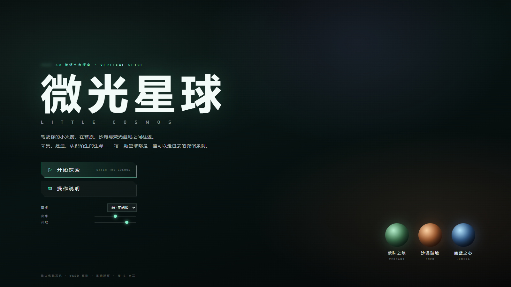 |  |
| 主菜单 | 蒙昧之绿 · 苔原与巨蕨 |
| 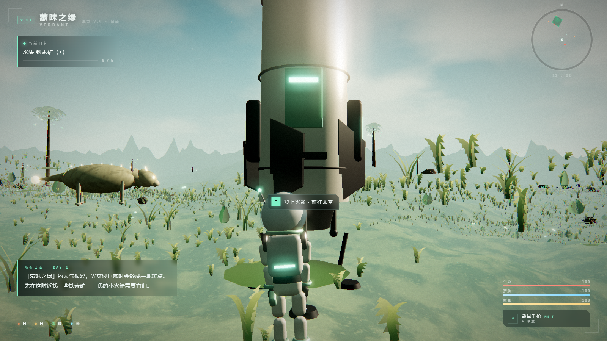 | 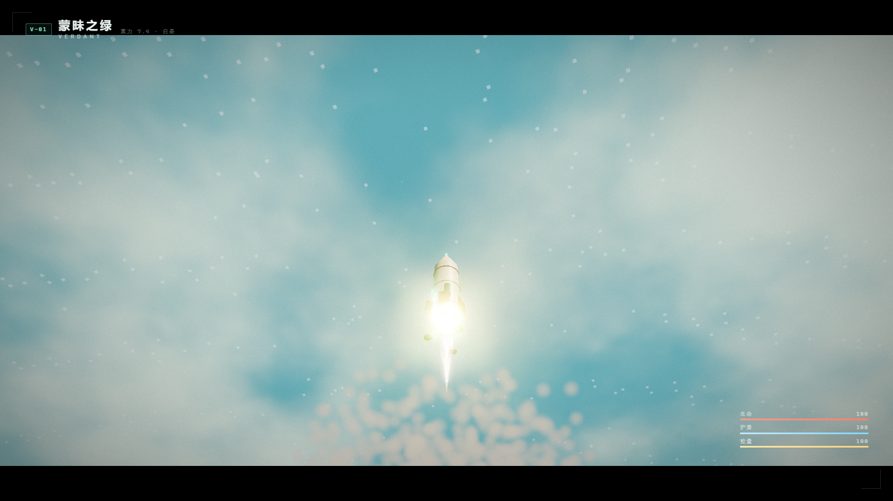 |
| 登船前的火箭 | 穿云上升 |
| 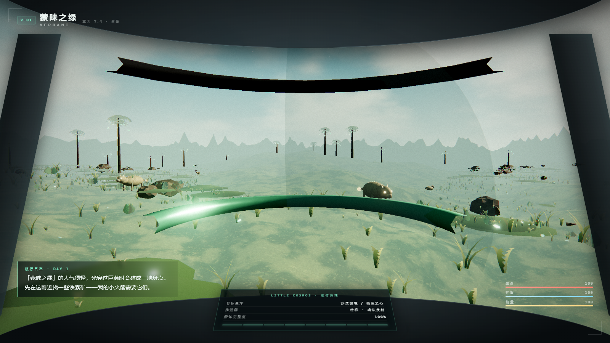 | 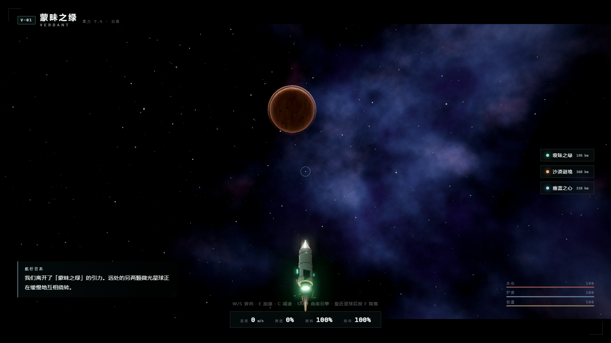 |
| 驾驶舱视角 | 太空航行 |
| 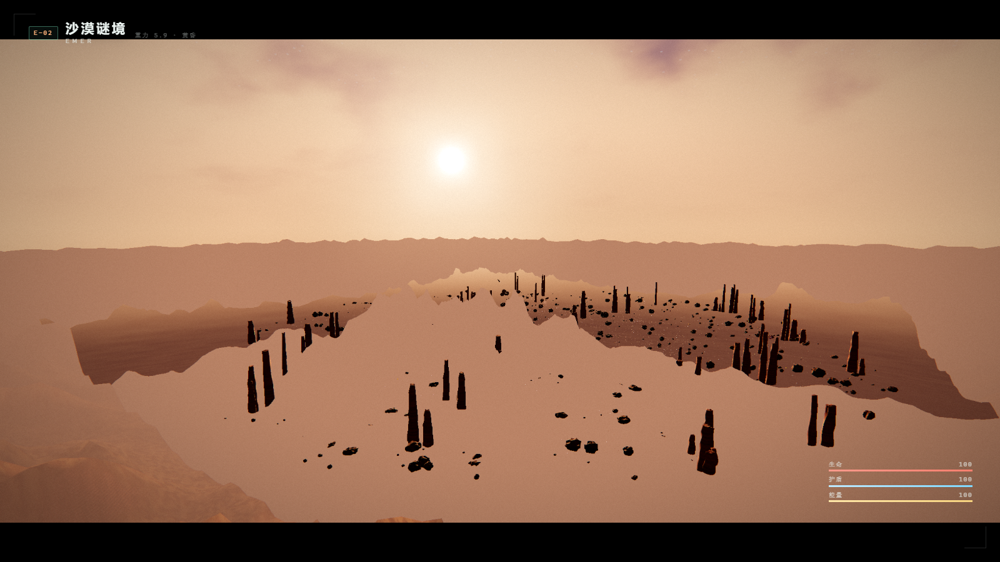 | 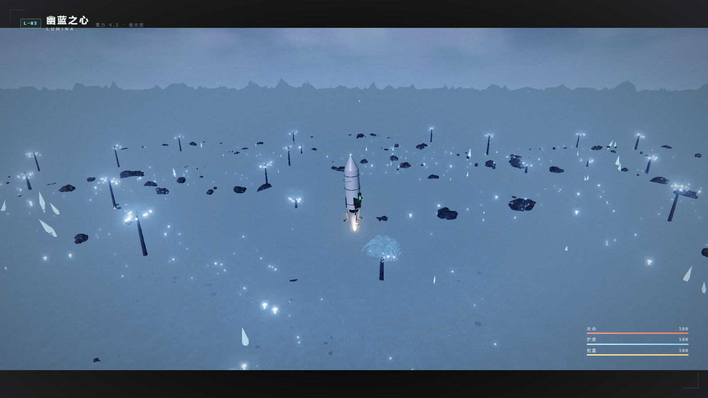 |
| 大气再入 | 着陆下降 |
| 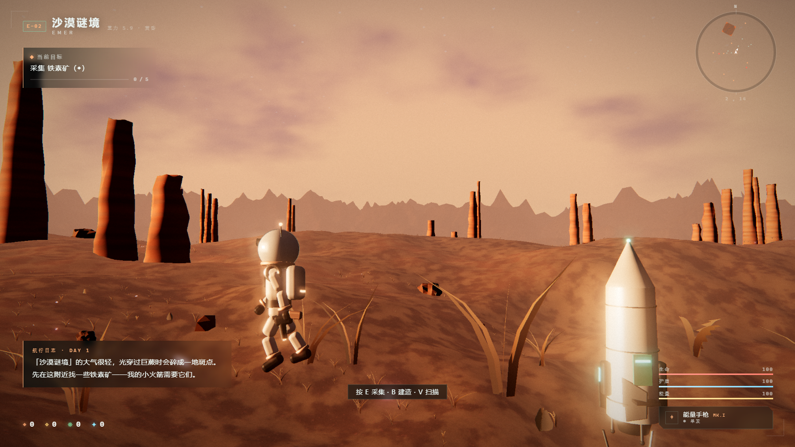 | 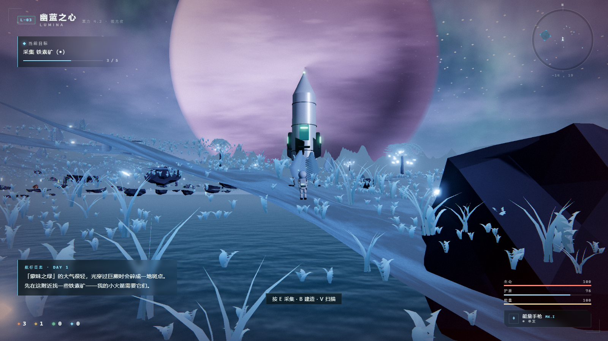 |
| 沙漠谜境 · 落日沙海 | 幽蓝之心 · 荧光湿地 |
| 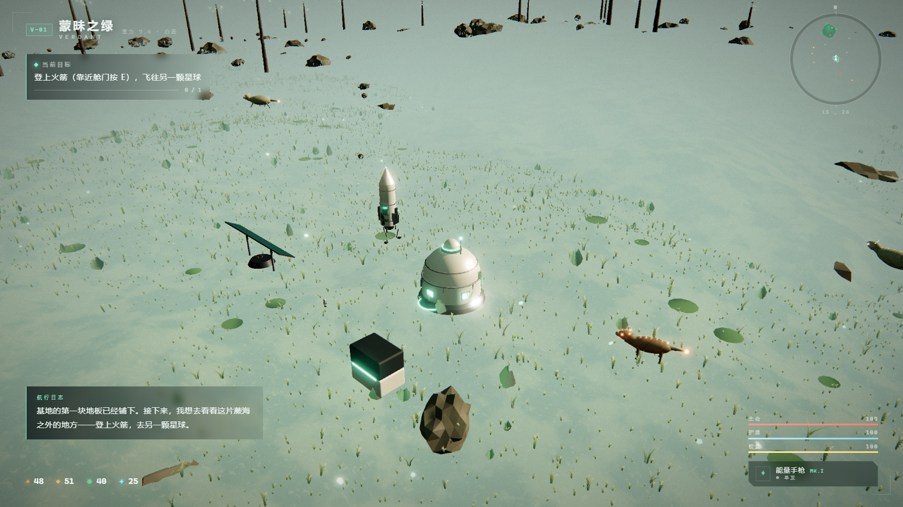 | 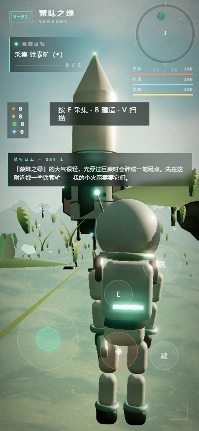 |
| 基地：居住舱 / 太阳能阵列 / 资源存储 | 移动端竖屏布局 |

---

## 三颗星球

| 星球 | 美术方向 | 特征 |
| --- | --- | --- |
| **蒙昧之绿 VERDANT** | 青苔草原、巨蕨森林、暖色天光 | 光柱穿过叶片、漂浮孢子、温和巨兽与森林掠食者 |
| **沙漠谜境 EMER** | 琥珀色沙海、落日、岩柱群 | 沙丘风纹、干裂河谷、沙暴、地下生物与夜行生物 |
| **幽蓝之心 LUMINA** | 幽蓝荧光湿地、极光、巨型行星 | 发光巨植、水晶、极光帘幕、天空中悬着的巨大行星 |

---

## 核心系统

- **程序化地形**：解析高度场 + 多重 LOD 环形网格（近处高精度、远处逐级变粗并重叠以防露缝），细节噪声完全在片元着色器中生成。
- **第三人称角色**：程序化生成的宇航员模型与程序化动画（行走 / 奔跑 / 跳跃 / 采集 / 瞄准 / 受击），每颗星球独立的重力与惯性。
- **无缝飞行**：登船 → 驾驶舱 → 点火 → 扬尘 → 穿云 → 大气 → 太空 → 接近 → 再入 → 火焰包覆 → 着陆 → 出舱，全程无黑屏，靠连续运镜与场景切换完成。
- **基地建造**：全息预览、网格吸附、旋转、合法性提示（坡度 / 水面 / 距离 / 重叠 / 资源）、确认后的升起动画；太阳能供电、采集无人机产出、居住舱回血。
- **战斗**：能量手枪（三种模式、能量条、后坐力、弹道与命中迸发），生物拥有漫游 / 觅食 / 警觉 / 追逐 / 攻击 / 逃跑 / 死亡等状态。
- **电影级后期**：ACES 色调映射 → UnrealBloom 泛光 → 输出色彩空间 → 自定义调色（暗角 / 胶片颗粒 / 色散 / 速度模糊 / lift-gain / 饱和度与对比度 / 受击血边 / 淡入淡出）。
- **程序化音频**：全部音效由 WebAudio 实时合成，另有生成式的氛围铺底与琶音。

---

## 技术要点

- **离线优先**：Three.js r170 与字体都已本地化，运行期对外网络请求数为 0（已用 `performance.getEntriesByType('resource')` 在 `file://` 下验证）。
- **单文件打包**：Rollup 输出 IIFE 到 `game.bundle.js`，因此 `file://` 直接可用。
- **抗锯齿策略**：不使用 MSAA 的 HDR 渲染目标（在部分驱动上会导致泛光通道读取到损坏数据、画面发黑），改为 1.4× 超采样，由浏览器做线性下采样。
- **泛光阈值**：阈值放在 HDR 线性空间（1.15），只让引擎焰、发光植物、太阳等真正的高光溢出，避免行星与天空这类大面积中高亮度被泛光洗白。
- **地形 LOD 接缝**：多层环形网格用圆形挖洞 + 边界重叠，掩盖不同分辨率造成的顶点错位。

---

## 已验证内容

以下项目均由无头 Edge 以真实输入回放（`file://` 协议）逐项验证：

| 项目 | 结果 |
| --- | --- |
| 离线运行 | `file://` 下资源请求数 0，WebGL2 正常运行 |
| 音频 | AudioContext `running` @48 kHz；音效创建振荡器节点；音乐序列器按 64 BPM 推进和弦 |
| 采集 | 采集 4–5 个矿点得 14–18 铁素矿，任务链推进到「建造居住舱」 |
| 建造 | 全息预览 / 合法性提示 / 确认扣费 / 升起动画；连续放置居住舱·太阳能·存储·科研站 |
| 战斗 | 掠食者 警觉→追逐→攻击，护盾 100→0、生命 100→81，可被 6 发击杀并淡出 |
| 死亡重生 | 生命归零后淡入淡出、回到登陆点、生命/护盾恢复并弹出「紧急复苏协议」 |
| 三种射击模式 | 单发 / 脉冲 / 散射循环切换，每次射击消耗 8 能量 |
| 扫描 | `V` 标记资源与生物到小地图并弹出提示 |
| 星球旅行 | VERDANT ↔ EMER ↔ LUMINA 三向往返，`atmos → landing → doors → exit → ground` 全流程到达 `surface` |
| 存档 | 写入 localStorage；返回菜单后「继续航行」出现，读档恢复资源与所在星球 |
| 移动端 | 390×844 布局无重叠；触摸摇杆推进角色 6.5 m |
| 帧率 | 桌面 1600×900 下 82–165 fps |

---

## 目录结构

```
little-cosmos/
├── index.html            界面结构与 HUD
├── style.css             设计系统、主题与响应式/触屏布局
├── game.bundle.js        打包产物（Rollup）
├── 启动游戏.bat          一键启动
├── vendor/fonts/         本地字体
├── src/
│   ├── main.js           游戏主控、场景装配、状态机、任务链
│   ├── core/             引擎、后期、噪声、输入、音频
│   ├── world/            主题配色、天空、地形、植被、水面、粒子、生物、资源
│   ├── player/           宇航员模型与动画、角色控制器、武器
│   ├── ship/             火箭模型、太空场景、飞行状态机
│   ├── base/             基地建造
│   └── ui/               HUD、小地图、提示与对话
└── tools/                本地服务器与自动化验证脚本
```

---

## 开发者工具

仓库内附带无头浏览器驱动的自动化验证脚本（用于截图与回归检查）：

```bash
node tools/serve.mjs                                  # 静态服务器
node tools/view.mjs http://localhost:8090 out.png     # 截图
node tools/drive.mjs out.png --script '[{"click":"#btn-start","after":3000}]'   # 真实输入回放
```

`tools/drive.mjs` 支持 `click` / `key` / `down` / `up` / `mouse` / `eval` / `wait` / `shot` 等动作，可以完整回放一段玩法流程并逐步截图。

调试钩子：在控制台通过 `window.__LC__` 访问游戏实例（例如 `__LC__.flight.phase`）。
